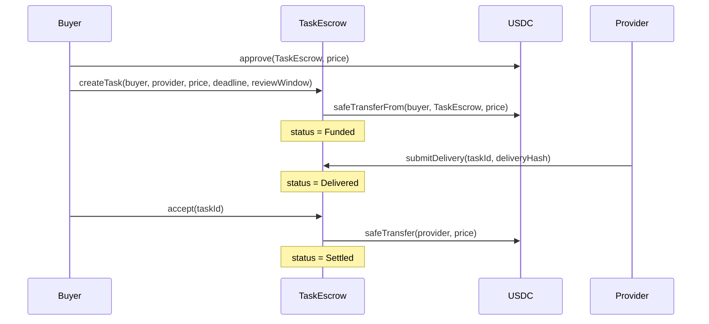
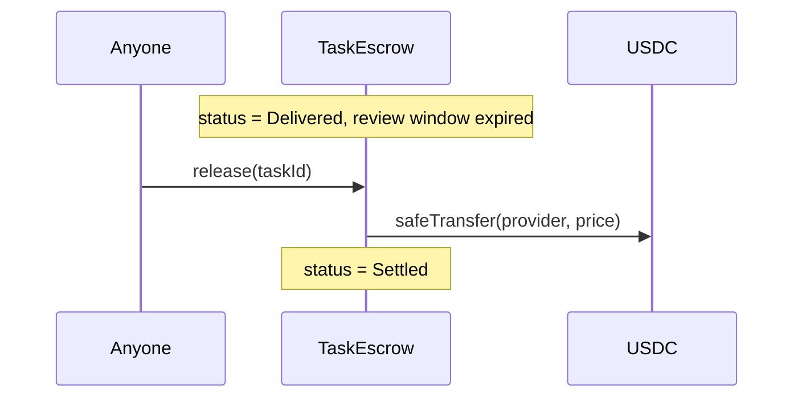
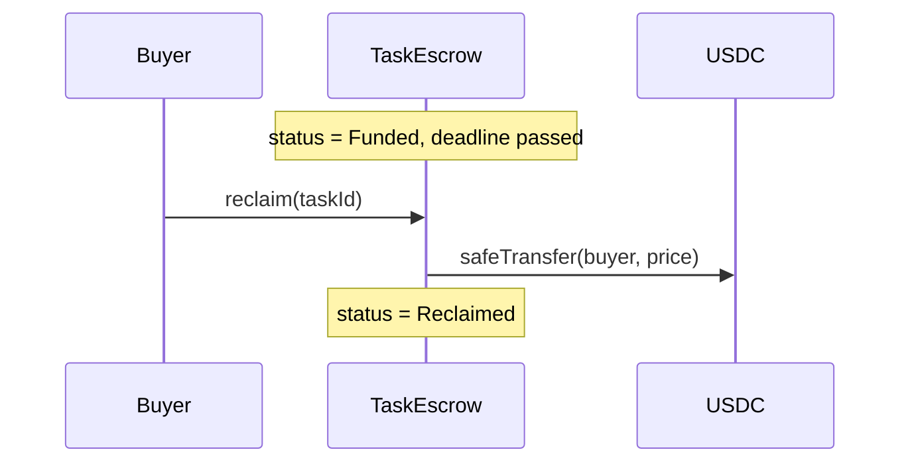

# TaskEscrow — Smart-Contract Design Document

**Status:** Draft  
**Target chain:** Arc Testnet (chain ID 5042002) / Arc Mainnet (chain ID 5042)  
**Language / Toolchain:** Solidity 0.8.x, Foundry  
**Milestone:** v1.0 — initial escrow with conditional payout and automatic release  

## Review tracker

- [ ] Design review
- [ ] Security review
- [ ] Ops review

---

## 1. Action Items (living)

- [x] Clarified reclaim destination: refund always goes to named buyer address, never to msg.sender or the original funder.
- [x] Confirmed third-party funding is safe: named buyer is never charged, never forced to act, and cannot be harmed by a third-party createTask call.
- [x] Defined deadline boundary rule: `block.timestamp > deadline` means the deadline has passed; `block.timestamp <= deadline` means it has not. submitDelivery is allowed when `block.timestamp <= deadline`; reclaim is allowed when `block.timestamp > deadline`. The two conditions are mutually exclusive.
- [x] Defined review-window boundary rule: `block.timestamp <= deliveredAt + reviewWindow` means the window is open (accept/reject allowed); `block.timestamp > deliveredAt + reviewWindow` means the window is closed (release allowed, accept/reject not allowed).
- [x] ERC-20 transfers only — no msg.value. SafeERC20 used throughout. USDC blacklist as a known limitation is documented.
- [x] USDC address kept as constructor argument for deploy-time verification.
- [x] Disputed state: funds permanently locked in v1 — stated in design and in NatSpec.

---

## 2. Goals / Non-Goals

### Goals

- Allow a **buyer** to create a task by naming a provider, a USDC price, a delivery deadline, and a review window, and fund the full price atomically.
- Allow a **provider** to submit a delivery hash before the deadline.
- Allow the buyer to **accept** a delivery (pays provider) or **reject** it (moves to Disputed state) during the review window.
- Allow anyone to **release** funds to the provider after the review window expires without buyer action (automatic release).
- Allow the buyer to **reclaim** full funds if the provider has not delivered by the deadline.
- Emit an event on every state change for full off-chain observability.
- Design the `createTask` entry point so a separate **auction contract** can call it on behalf of a buyer by passing the buyer address explicitly.

### Non-Goals

- Dispute resolution logic (v1 locks funds in `Disputed` state; resolution is future work).
- Partial payments, tip logic, or multiple providers.
- Fee collection or protocol treasury.
- Upgradeability (v1 is immutable; migration via new deploy if needed).
- Cross-chain bridging.
- Off-chain signature verification.

---

## 3. Requirements

### Functional

1. `createTask(buyer, provider, price, deadline, reviewWindow)` — callable by buyer OR a trusted caller contract (e.g. auction); transfers `price` USDC from `msg.sender` into the contract; status → `Funded`.
2. `submitDelivery(taskId, deliveryHash)` — only provider, only before deadline; status → `Delivered`.
3. `accept(taskId)` — only buyer, only after delivery, only within review window; transfers `price` to provider; status → `Settled`.
4. `release(taskId)` — anyone, only after delivery AND review window has expired; transfers `price` to provider; status → `Settled`.
5. `reclaim(taskId)` — only buyer, only if deadline has passed AND status is still `Funded` (provider never delivered); transfers `price` back to buyer; status → `Reclaimed`.
6. `reject(taskId)` — only buyer, only after delivery, only within review window; status → `Disputed`; funds stay locked.
7. All USDC transfers use `SafeERC20`.
8. Funds move exactly once per task.

### Security

- No owner or admin has any access to task funds.
- Every fund-moving function is guarded by `nonReentrant`.
- Every fund-moving function uses checks-effects-interactions ordering.
- Only the named buyer can call `accept`, `reject`, `reclaim`.
- Only the named provider can call `submitDelivery`.
- `price` must be > 0.
- `deadline` must be in the future.
- `reviewWindow` must be > 0.
- A task can only progress forward through the state machine; no state can be re-entered.

---

## 4. Terminology & Actors

| Term | Definition |
| --- | --- |
| **Task** | A unit of work: one buyer, one provider, one USDC price, one deadline, one review window. |
| **Buyer** | The party who funds the task and decides acceptance or rejection. |
| **Provider** | The party who performs the work and claims payment on acceptance or automatic release. |
| **Delivery hash** | An off-chain content identifier (e.g. IPFS CID, SHA-256 of a file) that the provider submits on-chain as proof of delivery. Not validated on-chain. |
| **Review window** | Duration (seconds) after delivery during which the buyer may accept or reject. After it expires anyone can trigger release. |
| **Deadline** | Unix timestamp by which the provider must submit delivery. If not met, the buyer may reclaim. |
| **Auction contract** | A future contract that calls `createTask` on behalf of a buyer, passing `buyer` explicitly. Treated as semi-trusted — it must have been pre-approved by the buyer (enforced off-chain). |

### Actor trust table

| Actor | On/off-chain | Trust level | What they can do |
| --- | --- | --- | --- |
| Buyer | On-chain EOA or contract | Trusted (within their task) | create, accept, reject, reclaim |
| Provider | On-chain EOA or contract | Trusted (within their task) | submitDelivery |
| Auction contract | On-chain contract | Semi-trusted (caller, not owner) | call createTask on buyer's behalf |
| Anyone (`release`) | On-chain | Untrusted | trigger release after window expires |
| Contract itself | On-chain | N/A — no admin powers | holds funds, executes rules |

---

## 5. Language / Runtime

- **Solidity 0.8.28** — checked arithmetic by default; `unchecked` used nowhere in this contract.
- **EVM target:** Paris (`evm_version = "paris"` per foundry.toml; Arc is EVM-compatible).
- **OpenZeppelin 5.1.0** — `SafeERC20`, `ReentrancyGuard`. (5.1.0 pinned to avoid Cancun `mcopy` incompatibility on the sandbox Paris target.)
- **No proxy / upgradeability** — immutable v1; a new address is the migration path.

---

## 6. Transaction & Execution Model

Execution is atomic (all state committed or all reverted). The contract never calls `msg.sender` back — it only calls the fixed USDC ERC-20 contract at `0x3600000000000000000000000000000000000000`. Re-entry surface: every function that moves USDC calls `SafeERC20.safeTransfer` / `safeTransferFrom`, both of which call into the USDC token. The USDC contract on Arc is Circle-controlled and non-re-entrant, but the contract applies both `ReentrancyGuard` (`nonReentrant`) and strict CEI ordering on every fund-moving function as defence-in-depth.

---

## 7. Chain Standards & Interfaces

- Interacts with USDC as **ERC-20** only (6 decimals, `safeTransfer` / `safeTransferFrom`).
- No EIP-712, Permit2, or ERC-1271 in v1.
- No cross-chain interfaces.

---

## 8. Architecture Overview

### State machine

```
          createTask
              │
         ┌────▼────┐
         │  Funded  │──── deadline passes, provider never delivered ──► reclaim ──► Reclaimed
         └────┬─────┘
              │ submitDelivery (before deadline)
         ┌────▼────────┐
         │  Delivered  │
         └─┬───┬───────┘
           │   │
    accept │   │ reject
    (buyer)│   │(buyer, within window)
           │   │
    ┌──────▼─┐ └──► Disputed (funds locked, no v1 resolution)
    │ Settled │
    └─────────┘
           ▲
           │
    release (anyone, after window expires)
```

### Sequence: happy path (buyer accepts)



### Sequence: automatic release (buyer ignores)



### Sequence: reclaim (provider misses deadline)



### Flow of funds

| Step | Who moves what | Invariant |
| --- | --- | --- |
| `createTask` | buyer → contract: `price` USDC | `contract.usdcBalance += price` |
| `accept` or `release` | contract → provider: `price` USDC | `contract.usdcBalance -= price` |
| `reclaim` | contract → buyer: `price` USDC | `contract.usdcBalance -= price` |
| `reject` | no movement | funds remain locked in contract |

**Resting-state invariant:** The contract holds exactly the sum of all `Funded` + `Delivered` + `Disputed` task prices. `Settled` and `Reclaimed` tasks contribute 0.

---

## 9. Contract Design

### Roles

| Role | Holder | Permissions | Notes |
| --- | --- | --- | --- |
| Buyer | per-task address | createTask, accept, reject, reclaim | set at task creation |
| Provider | per-task address | submitDelivery | set at task creation |
| Anyone | any caller | release (after window) | only triggers fund release |
| No admin | — | none | no privileged admin role exists |

### Storage layout

```solidity
enum TaskStatus { Funded, Delivered, Settled, Reclaimed, Disputed }

struct Task {
    address buyer;           // 20 bytes
    address provider;        // 20 bytes  (slot boundary)
    uint256 price;           // 32 bytes  (USDC, 6 decimals)
    uint64  deadline;        // 8 bytes
    uint64  reviewWindow;    // 8 bytes   (seconds)
    uint64  deliveredAt;     // 8 bytes   (timestamp of submitDelivery; 0 if not delivered)
    TaskStatus status;       // 1 byte    (packed with above three uint64s)
    bytes32 deliveryHash;    // 32 bytes
}

uint256 public taskCount;                       // monotonically incrementing task ID counter
mapping(uint256 => Task) public tasks;          // taskId => Task
address public immutable usdc;                  // USDC ERC-20 address (set in constructor)
```

### Modifiers

| Modifier | Guard |
| --- | --- |
| `nonReentrant` (OZ) | Prevents re-entrant calls on all fund-moving functions |
| `onlyBuyer(taskId)` | `msg.sender == tasks[taskId].buyer` |
| `onlyProvider(taskId)` | `msg.sender == tasks[taskId].provider` |

### Functions (write)

#### `createTask`

```
function createTask(
    address buyer,
    address provider,
    uint256 price,
    uint64  deadline,
    uint64  reviewWindow
) external nonReentrant returns (uint256 taskId)
```

| | |
|---|---|
| **Caller** | Any address (buyer calling directly, or an auction contract passing `buyer` explicitly) |
| **State mutated** | Increments `taskCount`; writes a new `Task` entry; pulls `price` USDC from `msg.sender` |
| **Events** | `TaskCreated(taskId, buyer, provider, price, deadline, reviewWindow)` |
| **Reverts** | `ZeroAddress` if buyer or provider is zero; `ZeroPrice` if price == 0; `DeadlineInPast` if deadline <= block.timestamp; `ZeroReviewWindow` if reviewWindow == 0; `BuyerProviderSame` if buyer == provider |

**Note on auction-contract support and third-party funding safety:** The caller passes `buyer` explicitly; `msg.sender` need not equal `buyer`. The USDC pull is always from `msg.sender` — the named buyer is NEVER charged, NEVER required to approve anything, and NEVER forced to take any action as a result of a third-party `createTask` call. The named buyer only gains rights (to accept, reject, or reclaim); no obligation is placed on them. A third party creating a task on a buyer's behalf cannot trap the buyer's funds, because the named buyer always retains the right to call `reclaim` if the provider misses the deadline. The worst case for the named buyer is receiving a task they did not ask for — but no funds leave the named buyer's wallet as a result.

#### `submitDelivery`

```
function submitDelivery(uint256 taskId, bytes32 deliveryHash) external
```

| | |
|---|---|
| **Caller** | Named provider only |
| **State mutated** | `tasks[taskId].status = Delivered`; `tasks[taskId].deliveredAt = block.timestamp`; `tasks[taskId].deliveryHash = deliveryHash` |
| **Events** | `DeliverySubmitted(taskId, deliveryHash)` |
| **Reverts** | `NotProvider`; `NotFunded` (status ≠ Funded); `DeadlinePassed` (block.timestamp > deadline) |

**Deadline boundary:** submitDelivery succeeds when `block.timestamp <= deadline` and fails when `block.timestamp > deadline`. This is the complement of reclaim's guard (`block.timestamp > deadline`), making the two conditions mutually exclusive at every timestamp including the exact deadline value.

#### `accept`

```
function accept(uint256 taskId) external nonReentrant
```

| | |
|---|---|
| **Caller** | Named buyer only |
| **State mutated** | `tasks[taskId].status = Settled` (BEFORE transfer — CEI) |
| **USDC transfer** | `price` → provider |
| **Events** | `TaskSettled(taskId, provider, price)` |
| **Reverts** | `NotBuyer`; `NotDelivered` (status ≠ Delivered); `ReviewWindowExpired` (block.timestamp > deliveredAt + reviewWindow) |

#### `release`

```
function release(uint256 taskId) external nonReentrant
```

| | |
|---|---|
| **Caller** | Anyone |
| **State mutated** | `tasks[taskId].status = Settled` (BEFORE transfer — CEI) |
| **USDC transfer** | `price` → provider |
| **Events** | `TaskSettled(taskId, provider, price)` |
| **Reverts** | `NotDelivered` (status ≠ Delivered); `ReviewWindowNotExpired` (block.timestamp <= deliveredAt + reviewWindow) |

#### `reclaim`

```
function reclaim(uint256 taskId) external nonReentrant
```

| | |
|---|---|
| **Caller** | Named buyer only |
| **State mutated** | `tasks[taskId].status = Reclaimed` (BEFORE transfer — CEI) |
| **USDC transfer** | `price` → `tasks[taskId].buyer` (the named buyer address, NOT msg.sender) |
| **Events** | `TaskReclaimed(taskId, buyer, price)` |
| **Reverts** | `NotBuyer`; `NotFunded` (status ≠ Funded); `DeadlineNotPassed` (block.timestamp <= deadline) |

**Reclaim destination:** The refund always goes to `tasks[taskId].buyer` — the address named at task creation — never to `msg.sender` or the original funder. Even if an auction contract created the task, the named buyer receives the refund. The caller must be the named buyer (`onlyBuyer` modifier enforces `msg.sender == tasks[taskId].buyer`), so in practice both addresses are the same, but the destination is expressed as the stored buyer address for clarity.

**Deadline boundary:** reclaim succeeds when `block.timestamp > deadline` and fails when `block.timestamp <= deadline`. This is the complement of submitDelivery's guard, making the two mutually exclusive.

#### `reject`

```
function reject(uint256 taskId) external
```

| | |
|---|---|
| **Caller** | Named buyer only |
| **State mutated** | `tasks[taskId].status = Disputed` |
| **USDC transfer** | None |
| **Events** | `TaskDisputed(taskId)` |
| **Reverts** | `NotBuyer`; `NotDelivered` (status ≠ Delivered); `ReviewWindowExpired` (block.timestamp > deliveredAt + reviewWindow) |

**Review-window boundary for reject:** The buyer may reject when `block.timestamp <= deliveredAt + reviewWindow`. Once the window has closed (`block.timestamp > deliveredAt + reviewWindow`), reject reverts with `ReviewWindowExpired`.

**Disputed funds are permanently locked in v1.** There is no resolution path. Funds held in `Disputed` tasks will remain in the contract until a v2 contract is deployed with a resolution mechanism. This is a known, intentional limitation of v1.

### Events

| Event | Parameters | When |
| --- | --- | --- |
| `TaskCreated` | `taskId, buyer, provider, price, deadline, reviewWindow` | createTask succeeds |
| `DeliverySubmitted` | `taskId, deliveryHash` | submitDelivery succeeds |
| `TaskSettled` | `taskId, provider, price` | accept or release succeeds |
| `TaskReclaimed` | `taskId, buyer, price` | reclaim succeeds |
| `TaskDisputed` | `taskId` | reject succeeds |

---

## 10. Specification tables

### 10.1 Principles

1. A task's USDC balance never changes while its status is `Disputed` — funds are locked until a future resolution mechanism is added.
2. Funds move at most once per task — the state is set to a terminal status before the transfer executes.
3. No function in this contract mints, burns, or borrows USDC — it is a pure escrow.
4. `deadline` and `reviewWindow` are immutable after `createTask`; no renegotiation.
5. No address has system-wide admin power; all rights are per-task and derived from task creation.

### 10.2 Functionalities

| Functionality | Restriction | Note | Event |
| --- | --- | --- | --- |
| Create task | Any caller; USDC approval required | buyer ≠ provider; price > 0; deadline future; reviewWindow > 0 | `TaskCreated` |
| Submit delivery | Only provider; before deadline; status = Funded | Records deliveryHash and deliveredAt | `DeliverySubmitted` |
| Accept delivery | Only buyer; status = Delivered; within review window | CEI + nonReentrant; pays provider | `TaskSettled` |
| Release (auto) | Anyone; status = Delivered; review window expired | CEI + nonReentrant; pays provider | `TaskSettled` |
| Reclaim | Only buyer; status = Funded; deadline passed | CEI + nonReentrant; refunds buyer | `TaskReclaimed` |
| Reject | Only buyer; status = Delivered; within review window | No fund movement; v1 no resolution | `TaskDisputed` |

---

## 11. Deployment & Initialization

- **Constructor arg:** `address usdc_` — the USDC ERC-20 address on the target chain.
  - Arc Testnet and Arc Mainnet: `0x3600000000000000000000000000000000000000`
- Reverts on zero address in constructor.
- No `initialize`/proxy pattern — constructor-only, immutable.
- No genesis balances required.
- **Init runbook:** Deploy → verify USDC address matches the target chain → confirm `taskCount == 0`.

---

## 12. Upgradeability

Not upgradeable (v1 design choice). If a breaking change is required, deploy a new contract at a new address. Existing tasks continue to settle on the old contract. Off-chain integrators re-point to the new address.

---

## 13. Key Management & Signing

No admin keys. No off-chain signing or EIP-712 in v1. Buyer and provider addresses are set at task creation and stored on-chain; no key rotation within a task's lifetime.

---

## 14. Security Considerations

| Vulnerability | Applicable? | Mitigation |
| --- | --- | --- |
| Reentrancy | Yes — safeTransfer / safeTransferFrom call into USDC contract | `nonReentrant` on all fund-moving functions; CEI ordering (status set terminal before transfer) |
| Access control | Yes — per-task buyer/provider roles | `onlyBuyer` / `onlyProvider` modifiers; status guards prevent double-execution |
| Integer overflow/underflow | Solidity ≥0.8 checked | No `unchecked` blocks used |
| Unchecked external call | Yes — USDC ERC-20 | `SafeERC20` wraps all calls; reverts on false return. ERC-20 interface only — no `msg.value` accepted or used anywhere |
| Fee-on-transfer tokens | Not applicable — USDC is not fee-on-transfer | No mitigation needed; contract is USDC-only (address set in constructor) |
| USDC blacklist | Known limitation — Circle can blacklist addresses | If the provider or buyer address is blacklisted at payout time, `safeTransfer` will revert, leaving funds locked in the contract. There is no automatic fallback recipient. This is a known limitation of v1 documented in the NatSpec. |
| Signature replay | Not applicable — no off-chain signatures in v1 | N/A |
| Front-running / MEV | Low — submitDelivery before deadline; deadlines are wide windows | Acceptable; no extractable value from ordering |
| Flash-loan / price manipulation | Not applicable — no price oracle | N/A |
| Oracle manipulation | Not applicable | N/A |
| Denial of service | Low — no loops; provider submitting to a task already delivered reverts cleanly | Pull pattern for all payouts; no push to unbounded arrays |
| Delegatecall / proxy safety | Not applicable — no proxy | N/A |
| Timestamp / block dependence | Yes — deadlines and review windows use block.timestamp | Tolerance is minutes to days (not seconds); acceptable for this use case |
| Approval persistence | Yes — buyer approves TaskEscrow before createTask | Exact-amount approval sufficient; no persistent max-approval required by contract |
| Centralization risk | None — no admin role | N/A |
| Auction-contract trust | Semi-trusted caller passes buyer explicitly | USDC pull is always from msg.sender; auction contract can only create tasks funded by its own approval; buyer must trust the auction contract off-chain before granting approval |
| deliveryHash collision | Low — 32-byte hash from off-chain content; no on-chain validation | Contract stores and emits the hash for off-chain verification; collision is a provider problem |

---

## 15. Trust Model & Threat Analysis

| Actor | Max damage if key compromised | Mitigation | Detection |
| --- | --- | --- | --- |
| Buyer (per-task) | Can reject a valid delivery (griefs provider into Disputed); cannot steal funds | No mitigation — buyer's right to reject is a design feature | `TaskDisputed` event; off-chain dispute system in v2 |
| Provider (per-task) | Can submit a fake delivery hash (no on-chain consequence until buyer acts) | Buyer reviews off-chain content before accepting | `DeliverySubmitted` event; buyer verification |
| Auction contract | Can create tasks and pull USDC from its own balance | Buyer must grant approval first; pull is always from msg.sender | Monitor unusual `TaskCreated` emitters |
| Anyone | Can call `release` after window — only pays provider, no theft | By design; any release is correct behaviour | `TaskSettled` event |

---

## 16. Emergency Response & Circuit Breakers

No pause mechanism in v1. Rationale: no admin can touch funds anyway; pausing would only prevent new task creation and delivery submissions, which adds governance complexity for marginal benefit. If a critical bug is found, the mitigation is to stop pointing new buyers at the contract (off-chain) and deploy a patched version. Existing tasks on the buggy contract must be manually tracked and resolved according to their state.

No `Rescuable` function: the USDC the contract holds is always owed to a specific task participant; a rescuer could drain live tasks. Mistakenly sent USDC (not via `createTask`) is permanently locked — callers should be warned.

---

## 17. Failure Scenarios

| Scenario | How it is handled |
| --- | --- |
| Provider submits delivery after deadline | `submitDelivery` reverts with `DeadlinePassed`; task stays `Funded`; buyer can reclaim |
| Buyer calls `accept` after review window | `accept` reverts with `ReviewWindowExpired`; `release` remains available |
| Buyer calls `reclaim` before deadline | `reclaim` reverts with `DeadlineNotPassed` |
| Provider submits delivery twice | Second `submitDelivery` reverts with `NotFunded` (status already `Delivered`) |
| Task is in `Disputed` — all actions | All state-advancing functions check status; none applies to `Disputed`; funds stay locked |
| `safeTransferFrom` fails (insufficient approval or balance) | Reverts atomically; task status unchanged; buyer can retry after fixing approval |
| `safeTransfer` fails (USDC paused) | Reverts atomically; task status unchanged; both parties wait for USDC to resume |
| Auction contract drains its own USDC for a task it didn't intend | Auction contract is responsible for its own approval management; TaskEscrow cannot over-pull |

---

## 18. Priorities & Tradeoffs

| Decision | Tradeoff | Rationale |
| --- | --- | --- |
| `buyer` passed explicitly to `createTask` | Requires auction contract to pass buyer; slightly more complex ABI | Enables auction-contract pattern without inheritance or factory coupling |
| No admin / rescue | Mistakenly sent USDC is permanently locked | Removes the single largest centralization vector; task funds are always traceable to a task |
| No pause | A bug can't be stopped on-chain | No admin role exists to hold the pause key; off-chain coordination is the emergency path |
| `deliveredAt` recorded on-chain | Extra storage slot | Required to compute review window expiry without oracle |
| Immutable USDC address | Contract must be redeployed to support a different token | Eliminates per-task token rug; acceptable for USDC-only escrow |
| Disputed state with no resolution | Funds locked indefinitely in v1 | Keeps v1 simple; dispute resolution is a hard problem deferred to v2 |

---

## 19. Testing Strategy

- **Unit tests (Foundry `.t.sol`):** 100% branch coverage target.
  - Happy paths: create → deliver → accept; create → deliver → release; create → reclaim.
  - Revert paths: every require / custom error (wrong caller, wrong status, wrong timing).
  - Event emission: every event checked with `vm.expectEmit`.
  - Fuzz: `price`, `deadline`, `reviewWindow` — key arithmetic (window expiry, deadline check).
  - Invariant: total USDC held by contract == sum of prices for `Funded` + `Delivered` + `Disputed` tasks.
- **Slither static analysis:** run before deploy; treat High/Medium as actionable.
- **Integration tests (post-deploy, optional):** createTask → submitDelivery → accept/release/reclaim on Arc Testnet.

---

## 20. Third-Party Libraries

| Library | Version | Already a dep? | Why | Security-reviewed? |
| --- | --- | --- | --- | --- |
| OpenZeppelin Contracts | 5.1.0 | Yes (pinned) | SafeERC20, ReentrancyGuard | Yes (OZ audited) |

---

## 21. Common Patterns / Worked Examples

### Example 1: Provider delivers, buyer accepts

1. Buyer calls `USDC.approve(TaskEscrow, 100_000000)` (100 USDC, 6 decimals).
2. Buyer calls `TaskEscrow.createTask(buyer, provider, 100_000000, block.timestamp + 7 days, 1 days)`.
   - Contract pulls 100 USDC from buyer.
   - `tasks[0] = { buyer, provider, price: 100e6, deadline: now+7d, reviewWindow: 1d, status: Funded }`.
   - Emits `TaskCreated(0, buyer, provider, 100e6, deadline, 86400)`.
3. Provider calls `TaskEscrow.submitDelivery(0, 0xabcd...)` before deadline.
   - `tasks[0].status = Delivered`; `deliveredAt = block.timestamp`.
   - Emits `DeliverySubmitted(0, 0xabcd...)`.
4. Buyer calls `TaskEscrow.accept(0)` within 1 day of delivery.
   - Status set to `Settled` (CEI), then 100 USDC transferred to provider.
   - Emits `TaskSettled(0, provider, 100e6)`.

### Example 2: Auction contract creates a task

1. Auction contract holds approval for 100 USDC.
2. Auction contract calls `TaskEscrow.createTask(buyerAddress, provider, 100e6, deadline, reviewWindow)`.
   - `msg.sender == auctionContract`; `buyer == buyerAddress`.
   - USDC pulled from auction contract.
   - Task created with `buyer = buyerAddress`.
3. All subsequent calls (accept, reject, reclaim) must come from `buyerAddress`.
